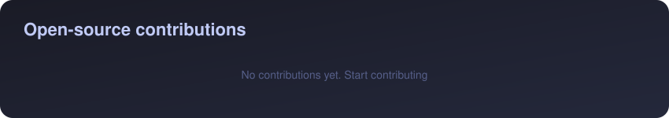

 

  

<h2 align="center">Hey, I'm Dely 👋</h2>

  <strong>Independent Developer · AI · Hardware · Web3</strong>

  Building real products, experimenting with new ideas, and shipping open source.

---

## 🚀 Top Projects

<table>
  <tr>
    <td width="50%" valign="top">
      <a href="https://github.com/imaaiagent/fumi">FUMI</a></h3>
      An open-source AI companion built on ESP32-S3 hardware, featuring animated expressions, voice interaction, and virtual pet mechanics.
        
      <strong>Stack:</strong> C++ · ESP32-S3 · AI
       
      <a href="https://fumi.codes/">Website</a> · <a href="https://github.com/imaaiagent/fumi">Source Code</a>
    </td>
    <td width="50%" valign="top">
      <a href="https://github.com/imaaiagent/clawit">Clawit</a></h3>
      An AI agent project exploring new ways to build and interact with AI-powered tools.
        
      <strong>Focus:</strong> AI Agents · Developer Tools
       
      <a href="https://github.com/imaaiagent/clawit">Source Code</a>
    </td>
  </tr>
  <tr>
    <td width="50%" valign="top">
      Catchaos</h3>
      An interactive web experiment exploring creative digital experiences.
        
      <strong>Focus:</strong> Web · Interactive Experiences
    </td>
    <td width="50%" valign="top">
      <a href="https://github.com/imaaiagent/PYRA">PYRA</a></h3>
      An AI agent project exploring on-chain payments and autonomous transactions.
        
      <strong>Focus:</strong> Solana · AI Agents · Payments
       
      <a href="https://github.com/imaaiagent/PYRA">Source Code</a>
    </td>
  </tr>
</table>

---

## 🧰 Tech Stack

**Languages**

  
  
  
  
  
  
  
  

**Frameworks & Tools**

  
  
  
  
  
  
  
  

**Hardware & Web3**

  
  
  
  

---

## 🌐 Find Me

- **GitHub:** [@imaaiagent](https://github.com/imaaiagent)
- **FUMI:** [fumi.codes](https://fumi.codes/)
- **Email:** community@fumi.codes

---

  

  <em>Building in public, learning from the community, and contributing along the way.</em>

  <strong>Make things. Ship things. Keep experimenting.</strong>

