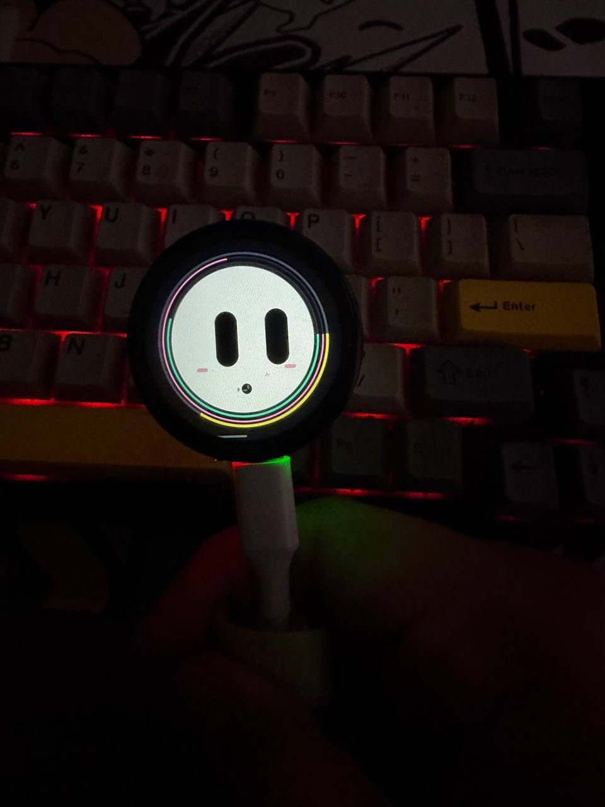

  

<h2 align="center">Hey, I'm Dely 👋</h2>

  Independent Developer · AI · Hardware · Web3

  Building things that connect AI with the real world.

---

### 🚀 Currently Building

<table>
  <tr>
    <td width="120" align="center">
      
    </td>
    <td>
      <h3><a href="https://github.com/imaaiagent/fumi">FUMI</a></h3>
      Open-source AI companion running on ESP32-S3 hardware.
        
      <a href="https://fumi.codes/">Website</a> ·
      <a href="https://github.com/imaaiagent/fumi">Source Code</a>
    </td>
  </tr>
</table>

### 🧰 Tech Stack

  
  
  
  
  
  
  

---

  <a href="https://github.com/imaaiagent">GitHub</a> ·
  <a href="https://fumi.codes/">FUMI</a> ·
  <a href="mailto:community@fumi.codes">Email</a>

Make things. Ship things. Keep experimenting.

